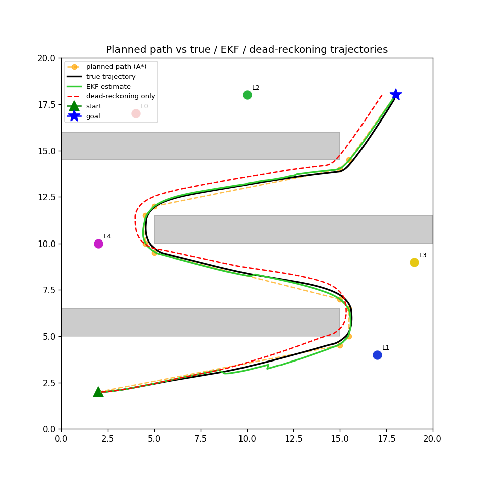

# 2D Mobile Robot Localization, Control, Perception and Navigation

A simulated differential drive robot that plans a path around obstacles with A*, detects landmarks from a simulated camera using classical computer vision, estimates its own pose with an Extended Kalman Filter written in C++, and follows the planned path with a PID controller driven by that estimate.



## Overview

| Stage | What it does | Where |
|---|---|---|
| Planning | A* on a grid, then line of sight path simplification | `python/planner.py` |
| Perception | Renders a camera view, finds landmarks by color and shape, estimates range and bearing | `python/perception.py` |
| Localization | Extended Kalman Filter fusing noisy odometry with landmark measurements | `cpp/src/ekf.cpp` |
| Control | PID waypoint follower driven by the EKF estimate | `python/controller.py` |
| Evaluation | Position error against odometry only dead reckoning, perception accuracy | `python/visualize.py` |

The EKF is C++ (Eigen) exposed to Python with pybind11. Everything else is Python. Perception uses classical computer vision on rendered images rather than ground truth landmark positions, so the filter only ever sees what a detector could actually report.

## Project structure

```
CMakeLists.txt          builds the EKF library, the Python module and the C++ tests
cpp/
  include/ekf.hpp       EKF class declaration
  src/ekf.cpp           predict() and update()
  bindings.cpp          pybind11 bindings, imported in Python as ekf_cpp
  tests/test_ekf.cpp    GoogleTest unit tests
python/
  environment.py        world, obstacles, landmarks and the five scenarios
  robot.py              differential drive (unicycle) motion model
  sensors.py            noisy odometry
  perception.py         camera rendering and landmark detection
  planner.py            A* path planner
  controller.py         PID waypoint controller
  simulate.py           main simulation loop
  visualize.py          plots, animation, live window, metrics
output/                 generated plots, animations and metrics
```

## How it works

### Extended Kalman Filter

State is `[x, y, theta]` with a 3x3 covariance.

- `predict(v, omega, dt)` moves the state with the unicycle motion model and propagates the covariance as `G P G^T + V M V^T`, where `G` is the motion Jacobian and `M` is control noise that grows with speed.
- `update(range, bearing, landmark_x, landmark_y)` computes the expected range and bearing to a known landmark, forms the innovation, and applies the standard Kalman gain `K = P H^T (H P H^T + Q)^-1`.

Landmark identity is known from perception (color and shape), so this is EKF localization with known correspondence.

### Perception

1. A camera view is rendered from the true pose with a pinhole model, a 90 degree field of view and a 10 unit range. Blur, brightness variation and occasional partial occlusion are added.
2. Each known landmark color is thresholded in HSV space, contours are extracted, and the shape (circle, square, triangle) is classified from polygon approximation and circularity.
3. Range comes from the equivalent pixel radius of the contour (`sqrt(area / pi)`) inverted through the pinhole model. Bearing comes from the contour centroid's horizontal offset.

`detect_landmarks(image)` returns `(landmark_id, range, bearing)` tuples and is the only function the rest of the pipeline depends on, so the detector can be swapped for another one without other changes.

### Planning and control

A* runs on a 0.5 unit grid with obstacles inflated by a safety margin, and the resulting path is simplified into long straight segments. The controller runs two PID loops (heading to angular velocity, distance to linear velocity) toward the current waypoint, using the EKF estimate as its pose. Forward speed is scaled by `cos(heading_error)` raised to a power so the robot slows sharply while turning.

### Collision handling

Obstacles are physical boundaries. Before each move, `simulate.py` checks the true candidate pose against every obstacle using the robot's body radius (`ROBOT_PHYSICAL_RADIUS`, smaller than the planner's safety margin). If the move would collide, it is refused and the robot reverses along a randomly chosen arc, then resumes normal control. The arc's turn rate and length are randomized and the whole swept arc is validated before it is used, so retries explore different escapes. In tight mazes this can take many steps.

### Localization quality

The EKF estimate comes from odometry corrected by landmark sightings. Dead reckoning uses the same odometry with no corrections, so its error grows without bound. With few landmarks the EKF estimate also drifts between sightings, which makes navigation less efficient and increases the number of collision recoveries.

## Scenarios

Select one with `--scenario NAME`. The default is `medium`.

| Scenario | Obstacles | Landmarks | Steps to goal | EKF RMSE | Dead reckoning RMSE | Improvement | Recall |
|---|---|---|---|---|---|---|---|
| `easy` | 4 scattered boxes | 5 | 435 | 0.652 | 0.829 | 1.27x | 63.9% |
| `medium` | 3 wall serpentine | 5 | 469 | 0.217 | 0.374 | 1.72x | 88.9% |
| `hard` | 4 wall serpentine, 4 unit gaps | 4 | 1,319 | 0.511 | 3.316 | 6.49x | 87.4% |
| `very_hard` | 5 wall serpentine, 4.5 unit gaps | 3 | 1,298 | 0.622 | 4.733 | 7.60x | 90.6% |
| `extreme` | same maze as `very_hard` | 2 | 13,542 | 3.967 | 17.533 | 4.42x | 41.2% |

Seeds used: 0 for `easy`, `medium` and `hard`, 2 for `very_hard`, 4 for `extreme`. RMSE is position error in world units. Step counts include collision recovery, and recovery is randomized, so other seeds give different step counts, especially in `extreme`.

## Results for the default scenario

From `output/metrics_summary_medium.txt`:

```
Goal reached: True
Steps taken: 469

EKF RMSE:             0.217 world units
Dead reckoning RMSE:  0.374 world units
Improvement:          1.72x

Perception precision: 100.0%
Perception recall:    88.9%
Mean range error:     0.591 world units
Mean bearing error:   0.342 degrees
```

Bearing is estimated much more accurately than range, because the horizontal position of a contour is a more reliable signal than its area.

Each scenario produces `overview_<name>.png`, `animation_<name>.gif`, `position_error_<name>.png` and `metrics_summary_<name>.txt` in `output/`.

## Build and run

### Requirements

- CMake 3.15 or newer
- A C++17 compiler (MSVC, GCC, Clang, or MinGW-w64 on Windows)
- Git
- Python 3.9 or newer

Eigen, pybind11 and GoogleTest are downloaded and built by CMake (`FetchContent`) the first time you configure. OpenCV is only used from Python.

```bash
python -m pip install numpy matplotlib opencv-python pillow
```

### Build

```bash
cmake -S . -B build
cmake --build build -j4
```

On Windows with MinGW use `cmake -S . -B build -G "MinGW Makefiles"`. A MinGW build needs a few runtime DLLs next to the Python module, and the CMake file copies them automatically after the build.

This produces `python/ekf_cpp*.pyd` (or `.so`) and `build/test_ekf`.

### Test

```bash
./build/test_ekf          # Linux and macOS
.\build\test_ekf.exe      # Windows
```

### Run

```bash
cd python
python simulate.py                                  # run once and print a summary
python visualize.py                                 # save plots, animation and metrics to output/
python visualize.py --scenario hard                 # choose a scenario
python visualize.py --scenario easy --live          # interactive window
python visualize.py --scenario extreme --seed 4     # choose a seed
```

`--live` opens a window with the robot at its start pose. Press SPACE or click Start / Restart to run it, and use the same control to run it again. Live mode does not save files. `--seed N` seeds odometry noise, perception noise and collision recovery.

## Possible extensions

- A path following controller with lookahead (pure pursuit) in place of waypoint chasing.
- Wall following (Bug family) recovery in place of randomized reversing.
- Planning that accounts for the EKF covariance.
- A trained detector behind the same `detect_landmarks` signature.
- A particle filter for comparison with the EKF.
- Dynamic obstacles with online replanning.
- Landmark visibility blocked by obstacles.
- Mahalanobis gating of measurements in the EKF update.
